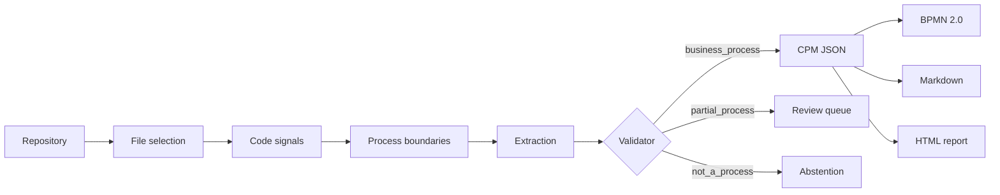
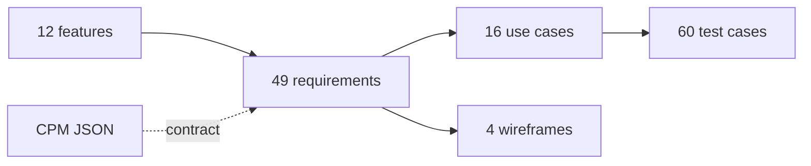

# Process Atlas

Business process extraction, documentation and BPMN visualization.

Process Atlas reads source material, decides whether it contains a business process, captures that process as a
Canonical Process Model (CPM) in JSON, documents it, and projects it into BPMN 2.0. It is implemented here as a
specification set, an extraction contract, a deterministic validator, and a runnable agent that works on code
repositories today.

Repository: <https://github.com/ManuNellutla/BPMX>

---

## Contents

- [What this repository contains](#what-this-repository-contains)
- [Quickstart](#quickstart)
- [The extraction agent](#the-extraction-agent)
- [The validator](#the-validator)
- [The design set](#the-design-set)
- [The canonical artefact](#the-canonical-artefact)
- [Evidence model](#evidence-model)
- [Coverage and status](#coverage-and-status)
- [Repository map](#repository-map)
- [Extending](#extending)
- [Limitations](#limitations)
- [Further reading](#further-reading)

---

## What this repository contains

| Layer | Artefact | Purpose |
| --- | --- | --- |
| Product specification | `designs/` | 12 features, 49 requirements, 16 use cases, 60 test cases, 4 wireframes |
| Extraction contract | `designs/prompts/` | Domain context, prompt, output envelope, self-check |
| Validator | `designs/prompts/validate_extraction.py` | Decides whether an extraction is a process or an arbitrary payload |
| Agent | `agent/` | Runs the contract against a repository and writes CPM, BPMN, Markdown and HTML |
| Example | `agent/examples/orders-service/` | A small codebase with two configured processes |

Three capabilities drive the design:

1. **Extraction** — find activities, actors, decisions, evidence and business value in code, documents, diagrams,
   images, video and text.
2. **Documentation** — persist the model and produce briefs, step tables and traceable evidence.
3. **Visualization** — render the model as BPMN 2.0 and as review, provenance and portfolio views.

The agent currently implements the code path end to end. The remaining source types are specified and gated by the
same contract; they are not implemented yet.

---

## Quickstart

No dependencies beyond Python 3.10+. No build step, no package install.

```bash
git clone git@github.com:ManuNellutla/BPMX.git
cd BPMX

# 1. run the bundled extraction checks
python3 agent/atlas.py selftest

# 2. extract the example repository
python3 agent/atlas.py run agent/examples/orders-service --out agent/atlas-out

# 3. open the generated report
xdg-open agent/atlas-out/prj_orders_platform/index.html
```

Expected output:

```
Invoice to Cash     business_process  100   5 activities   2 lanes   quotes 8/8
Order Fulfilment    business_process  100   3 activities   1 lane    quotes 6/6
```

Validate the contract independently:

```bash
python3 designs/prompts/validate_extraction.py --self-test
# 9/9 fixtures matched

python3 designs/prompts/validate_extraction.py \
  agent/atlas-out/prj_orders_platform/processes/invoice_to_cash/cpm.json
```

Open the specification hub directly in a browser — it is static HTML with no server requirement:

```bash
xdg-open designs/index.html
```

### Run on your own repository

```bash
python3 agent/atlas.py run /path/to/repo --out ./atlas-out

# inspect boundaries without extracting
python3 agent/atlas.py discover /path/to/repo
```

Without a config, the agent clusters process signals by module and emits one process per cluster. Add a
`process-atlas.json` at the repository root to name the processes, declare actors, order the steps and state the
business outcome.

### Use a model instead of the offline baseline

```bash
export ANTHROPIC_API_KEY=sk-ant-...
python3 agent/atlas.py run /path/to/repo --provider anthropic
```

`auto` (the default) uses `ANTHROPIC_API_KEY` or `OPENAI_API_KEY` when present, otherwise the offline heuristic
provider. The model receives the context and prompt from `designs/prompts/`, and its output is validated and
audited exactly like the heuristic output.

---

## The extraction agent



Commands:

```bash
python3 agent/atlas.py run SOURCE [--config FILE] [--out DIR] [--provider auto|heuristic|anthropic|openai]
python3 agent/atlas.py discover SOURCE
python3 agent/atlas.py validate FILE [--json] [--verbose]
python3 agent/atlas.py selftest
```

Exit codes: `0` every process accepted, `1` partial or mixed, `2` nothing accepted, `3` bad input or provider error.

Output per project:

```
atlas-out/<projectId>/
  index.html                  dashboard: verdicts, scores, outcomes, quote verification
  run.json                    manifest: files, signals, provider, findings, errors
  portfolio.json              scope and value per process
  processes/<slug>/
    cpm.json                  canonical process model
    process.bpmn              BPMN 2.0 projection with deterministic layout
    process.md                scope, actors, steps, decisions, value, evidence, validation
    extraction.json           provider envelope
    validation.json           gate report, metrics, findings, evidence audit
```

The agent detects route handlers, Python decorators, queue consumers, cron jobs and exported functions. It maps each
signal to a verb–object activity, a lane from path rules, a code locator and a verbatim quote. Decisions and business
values are declared in config for heuristic runs, and may be inferred in model-backed runs.

Minimal configuration:

```json
{
  "projectId": "prj_orders_platform",
  "projectName": "Orders Platform",
  "domain": "Sales",
  "include": ["src/**/*.ts"],
  "exclude": ["**/*.test.ts"],
  "actors": [
    { "match": "src/billing/**", "lane": "Billing Operations", "type": "internal" },
    { "match": "src/collections/**", "lane": "Collections", "type": "internal" }
  ],
  "processes": [
    {
      "id": "invoice_to_cash",
      "name": "Invoice to Cash",
      "domain": "Finance",
      "trigger": "Invoice issued and payment due",
      "outcome": "Cash collected and receivable closed",
      "include": ["src/billing/**/*.ts", "src/collections/**/*.ts"],
      "sequence": ["Issue invoice", "Apply payment", "Run dunning"],
      "ignore": ["Retrieve invoice"],
      "decisions": [
        {
          "after": "Run dunning",
          "name": "Payment recovered?",
          "branches": [
            { "condition": "payment recovered", "target": "$end" },
            { "condition": "payment not recovered", "target": "Place credit hold" }
          ]
        }
      ],
      "value": {
        "lever": ["cycleTime"],
        "outcome": {
          "statement": "Reduce DSO from 48 to 38 days",
          "kpi": "DSO", "baseline": 48, "target": 38,
          "unit": "days", "horizon": "2 quarters", "basis": "assumption"
        }
      }
    }
  ]
}
```

Full configuration reference, provider details and output semantics: [`agent/README.md`](agent/README.md).

---

## The validator

The validator answers two questions separately, and never conflates them.

| Question | Gate | Failure means |
| --- | --- | --- |
| Is this a business process at all? | identity | The payload is an arbitrary extraction: fields, headings, roles, a single task |
| Is the process acceptable as a model? | compliance | It is a process, but lanes, terminals, evidence or scope are incomplete |

A field list with perfect JSON is `not_a_process`. A genuine sequence with no actor is `partial_process`, not a
rejection.

| Verdict | Score | Exit | Meaning |
| --- | --- | --- | --- |
| `business_process` | 76–100 | 0 | Identity and compliance pass |
| `partial_process` | 50–74 | 1 | A process, contract incomplete |
| `not_a_process` | 0–45 | 2 | Not a process |
| — | — | 3 | Unreadable input |

A correct abstention — `isBusinessProcess: false` with `process: null` — is reported as `not_a_process` with score
`100`, `abstained: true` and `agreement: true`. Abstaining correctly is a success; inventing a process is the worst
failure mode.

Nine labelled fixtures cover the negative archetypes: entity list, document summary, org chart, single activity,
merged multi-process, missing actors, noun-based labels and correct abstention. They are asserted by `--self-test`
and documented in [`designs/prompts/validator.md`](designs/prompts/validator.md).

The standalone validator reads no source files, so it reports `verbatim: unverified offline`. The agent closes that
gap: it opens every `path` + `startLine` locator, compares the quote, and reports `matched/checked` in
`validation.json` and on the dashboard.

---

## The design set

The HTML documents are the product specification: linked, traceable, and static.

| Document | Contents |
| --- | --- |
| [`designs/index.html`](designs/index.html) | Traceability hub, document index, coverage, artefact contract |
| [`designs/features.html`](designs/features.html) | 12 features across extraction, documentation and visualization |
| [`designs/requirements.html`](designs/requirements.html) | 49 requirements with acceptance criteria, 16 use cases, 10 quality gates |
| [`designs/test-cases.html`](designs/test-cases.html) | 60 test cases in suites A–J, traceability matrix |
| [`designs/wireframes/index.html`](designs/wireframes/index.html) | Four UI samples and rendering rules |
| [`designs/samples/cpm-invoice-to-cash.json`](designs/samples/cpm-invoice-to-cash.json) | Canonical model example |



Requirement groups:

| Group | Count | Scope |
| --- | --- | --- |
| `REQ-EXT` | 15 | Intake, interpretation, evidence |
| `REQ-VAL` | 6 | Typed value block and outcomes |
| `REQ-DOC` | 10 | Documentation, review, versioning |
| `REQ-VIZ` | 12 | BPMN projection, canvas, overlays |
| `REQ-MOD` | 6 | Model, API and persistence |

Wireframes:

1. **BPMN canvas** — lanes, evidence badges, confidence bars, finding outline, value heat, inspector.
2. **Evidence and provenance** — citation chain, captured fields, PDF/video/code locators.
3. **Portfolio value** — KPI strip, value-vs-effort matrix, priority formula, assumptions.
4. **Review and compare** — queue, diff overlay, version comparison.

All wireframes are static HTML/CSS/SVG. Controls are intentionally non-interactive.

---

## The canonical artefact

The CPM is the single source of truth. BPMN, Markdown, dashboards, tables and canvases are projections; none of them
is reconstructed back into the model.

```json
{
  "schemaVersion": "1.0.0",
  "id": "prc_...",
  "name": "Invoice to Cash",
  "domain": "Finance",
  "scope": { "trigger": "...", "outcome": "..." },
  "lanes": [],
  "nodes": [],
  "edges": [],
  "value": {},
  "candidates": [],
  "assumptions": [],
  "openQuestions": [],
  "provenance": {}
}
```

Every node has an ID, a BPMN type, a verb–object name, exactly one lane, a confidence value and at least one evidence
entry. IDs are stable across export and re-import; BPMN extension elements carry the evidence so a modeler does not
lose provenance.

BPMN export is deterministic: lane bands, longest-path columns, stable IDs, diagram interchange for every shape and
edge. Re-running on unchanged sources produces byte-identical CPM, BPMN and Markdown; only `generatedAt` timestamps
differ.

---

## Evidence model

A flow element without evidence is an assertion, not an extraction. Every element carries:

| Field | Detail |
| --- | --- |
| Locator | PDF page + bounding box, image region, code `path` + line range, or video timecode range |
| Quote | Verbatim text from the source, ≤ 240 characters |
| Confidence | `0–1`; below `0.70` belongs in `candidates[]`, not `nodes[]` |

Confidence bands: `≥ 0.85` explicit statement, `0.70–0.85` implied by adjacent text or code, `< 0.70` ambiguous and
therefore a candidate. Unsupported content is never silently promoted.

---

## Coverage and status

| Item | Count |
| --- | --- |
| Features | 12 |
| Requirements | 49 |
| Use cases | 16 |
| Test cases | 60 (48 P0, 12 P1) |
| Quality gates | 10 |
| Wireframes | 4 |
| Validator fixtures | 9 |
| Demo processes | 2 |

Verification:

```bash
python3 designs/prompts/validate_extraction.py --self-test   # 9/9 fixtures
python3 agent/atlas.py selftest                                # 16/16 checks
```

The agent self-test covers discovery, extraction, verdicts, quote resolution, BPMN parsing, deterministic IDs and
abstention on a repository with no process signals.

| Capability | Status |
| --- | --- |
| Code repository intake and signal scanning | Implemented |
| CPM build, persist and validate | Implemented |
| Evidence audit against source files | Implemented |
| BPMN 2.0 export with DI | Implemented |
| Markdown documentation and HTML report | Implemented |
| Offline heuristic provider | Implemented |
| Anthropic and OpenAI providers | Implemented, require API key |
| PDF, image and video interpretation | Specified, not implemented |
| Cross-source fusion | Specified, not implemented |
| Incremental extraction | Specified, not implemented |
| BPMN 2.0 import | Specified, not implemented |
| Interactive review UI | Specified as wireframes, not implemented |

---

## Repository map

```
BPMX/
├── README.md                     this file
├── .gitignore
├── agent/
│   ├── atlas.py                  CLI entry point
│   ├── cli.py                    commands and arguments
│   ├── pipeline.py               orchestration and output writing
│   ├── config.py                 process-atlas.json, targets, auto-discovery
│   ├── sources.py                file walker and code-signal scanner
│   ├── build.py                  offline CPM builder
│   ├── prompting.py              system prompt and focused source bundle
│   ├── providers.py              heuristic, Anthropic, OpenAI
│   ├── validation.py             validator bridge and evidence audit
│   ├── render.py                 BPMN, Markdown, dashboard
│   ├── selftest.py               16 end-to-end checks
│   ├── README.md                 agent reference
│   ├── examples/
│   │   └── orders-service/       runnable demo repository and config
│   └── atlas-out/                generated output, git-ignored
└── designs/
    ├── index.html                traceability hub
    ├── features.html             12 features
    ├── requirements.html         49 requirements, 16 use cases, 10 gates
    ├── test-cases.html           60 test cases and traceability matrix
    ├── assets/styles.css         shared theme
    ├── samples/
    │   └── cpm-invoice-to-cash.json
    ├── prompts/
    │   ├── context.md            definitions, process test, archetypes, rules
    │   ├── prompt-extract-process.md
    │   ├── validator.md          gates, weights, patterns, report shape
    │   ├── validate_extraction.py
    │   └── fixtures/             9 labelled payloads
    └── wireframes/
        ├── index.html            gallery and rendering rules
        ├── 01-bpmn-canvas.html
        ├── 02-evidence-provenance.html
        ├── 03-portfolio-value.html
        └── 04-review-compare.html
```

---

## Extending

**Add a language convention.** Extend the regexes in `agent/sources.py` (`ROUTE_RE`, `DECORATOR_RE`, `QUEUE_RE`,
`CRON_RE`, `FUNC_RE`) and make sure the derived label starts with a known verb. Verb vocabulary lives in
`designs/prompts/validate_extraction.py` under `VERBS`.

**Add a rule.** Add the rule code, weight, category and remediation to `RULES` in the validator, emit it in
`validate_process`, document it in `designs/prompts/validator.md`, and add a fixture that proves it. Run
`--self-test` before and after.

**Add a fixture.** Save the payload under `designs/prompts/fixtures/`, add its expected verdict and pattern to the
`cases` list in `run_self_test()`, and run the suite. Never edit an expectation only to make a test green.

**Change the prompt.** Increment the prompt version; record it in the run manifest. A prompt change must not alter
IDs or the envelope shape without a corresponding validator and schema change.

---

## Limitations

- Code extraction is heuristic: it recognises common construct shapes, not every framework.
- Heuristic ordering comes from config or declaration order; it does not read handler bodies for control flow.
- Decisions and business values are configured for heuristic runs, not inferred. Model-backed runs may infer them;
  the validator then checks them.
- Actors are path rules; role inference is a model task.
- Quote auditing is line-level. Multi-line constructs are represented by their first line.
- Verb detection and label generation are English-only.
- PDF, image and video intake, cross-source fusion, incremental extraction and BPMN import remain specification-only.

---

## Further reading

| Document | Why read it |
| --- | --- |
| [`agent/README.md`](agent/README.md) | Full agent reference: config schema, providers, outputs, traceability |
| [`designs/prompts/context.md`](designs/prompts/context.md) | What a business process is, and what it is not |
| [`designs/prompts/prompt-extract-process.md`](designs/prompts/prompt-extract-process.md) | System prompt, envelope, self-check, calibration |
| [`designs/prompts/validator.md`](designs/prompts/validator.md) | Identity and compliance gates, scoring, fixtures |
| [`designs/index.html`](designs/index.html) | The linked specification set |
| [`designs/README.md`](designs/README.md) | Index and conventions for the design documents |
